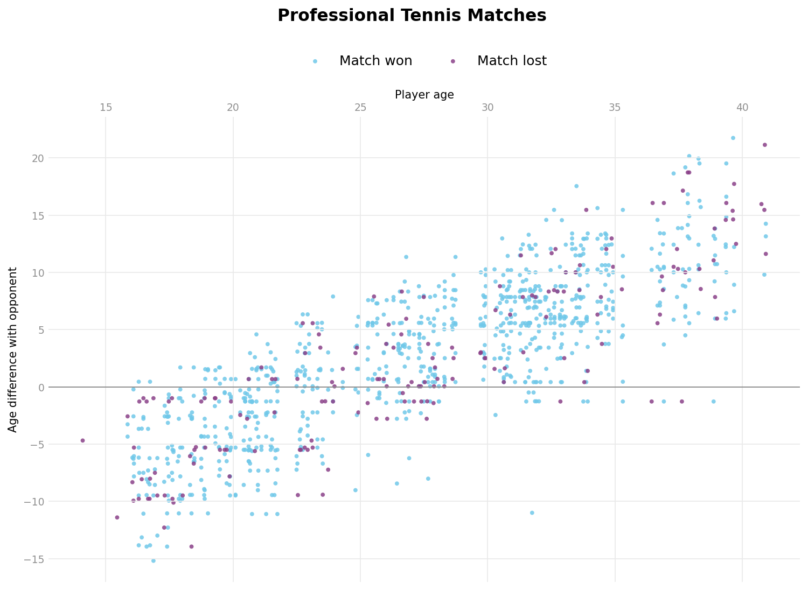

# tennis-career

## Overview

`tennis-career` is a Python package for retrieving, cleaning, and visualizing professional tennis career-match data from Tennis Abstract. Given a player name, it resolves the corresponding career data, returns a standardized `pandas.DataFrame`, and produces a scatter plot of the player's age against the age difference with each opponent.

## Installation

The package requires Python 3.10 or later. Install it from GitHub with:

```bash
pip install git+https://github.com/UCB-stat159-f26/hw03-3-joshuarzc.git
```

## Usage

### Get career-match data

`get_career_matches()` retrieves a player's career records and returns one clean row per match. The result includes `match_date`, `tournament`, `surface`, `result`, `opponent`, `player_age`, `opponent_age`, and `age_difference`.

```python
from tennis_career import get_career_matches

matches = get_career_matches("Serena Williams")
print(matches.head())
```

### Create a career-match plot

`plot_career_matches()` takes the clean data frame returned by `get_career_matches()` and returns a Matplotlib figure. Match results are colored by outcome.

```python
from tennis_career import plot_career_matches

figure = plot_career_matches(matches)
figure.savefig("serena-career.png", dpi=150)
```



*Career matches for Serena Williams, with points colored by match result.*

## Data source

Match records and player metadata are retrieved at runtime from [Tennis Abstract](https://www.tennisabstract.com/) JavaScript files. The package does not redistribute raw match data. Female career files record opponents' dates of birth, from which opponent ages are calculated using match dates. Male career files provide opponent ages directly.

## Development and testing

To verify the package and work on its development, install the test dependency and run the suite from the project root:

```bash
pip install -e ".[test]"
python -m pytest
```

The tests use local mock data and do not access Tennis Abstract.

## Reflections

In this project, I realized that public interfaces are crucial for packages. I needed to decide which two functions a user should call, what each function should accept or return, and which retrieval and parsing steps should remain private. I also learned the concrete role of `pyproject.toml`, as it defines the package's dependencies and metadata, which are essential for making the code usable outside my own working directory.

Moreover, I learned how to structure a Python package for reusability. For example, the same opponent field has different meanings in the two career-file formats. Female records store an eight-digit birth date, so the package calculates opponent age from the match date. Male records store opponent age directly, so the package uses the age directly.

Furthermore, I learned how to handle online data sources. I used small local JavaScript test files, which made it possible to test the cleaning logic without relying on remote data during automated tests.

## License

This project is released under the [MIT License](LICENSE).
